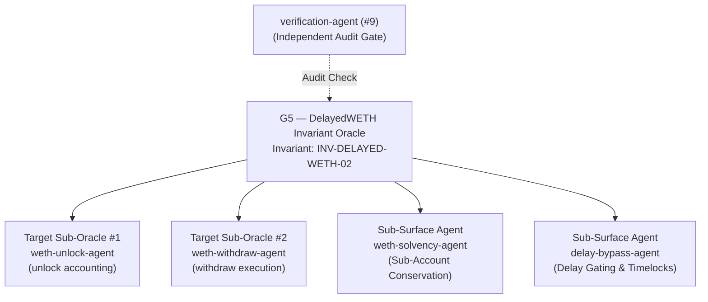

# G5 — DelayedWETH Invariant Oracle

**Slug:** `delayed-weth-invariant-oracle`  
**SKILL.md:** `.agents/skills/delayed-weth-invariant-oracle/SKILL.md`  
**Domain:** Resolved dynamically via `TargetContext` (`context.target_root`, `context.scope_manifest`, `context.architecture` e.g. `DelayedWETH.sol`)  
**Supervised Invariant:** `INV-DELAYED-WETH-02` (DelayedWETH Sub-Account Solvency & Delay Integrity)  
**Privilege:** Read-Write on DelayedWETH invariant test harnesses; Read-Only on canonical protocol source.

---

## Purpose

The DelayedWETH Invariant Oracle (G5) governs invariant testing for bonded collateral and delayed withdrawal vaults under USAP and Glassbox Mirror Plane Orchestration. It ensures that total contract reserves strictly cover all pending delayed unlock claims, that sub-account balances cannot be stolen or diluted, and that unlock time locks cannot be bypassed under any execution path.

---

## Supervised Agents

| Agent | Level | Domain / Role |
|---|---|---|
| `weth-unlock-agent` | Target Sub-Oracle #1 | Verifies sub-account unlock initiation, timestamp recording, and allowance gating. |
| `weth-withdraw-agent` | Target Sub-Oracle #2 | Verifies post-delay withdrawal execution, balance subtractions, and reentrancy resistance. |
| `weth-solvency-agent` | Sub-Surface Attestation | Enforces mathematical solvency: `address(this).balance >= sum(subAccounts) + claims`. |
| `delay-bypass-agent` | Sub-Surface Attestation | Verifies timestamp checks (`block.timestamp >= unlocks[msg.sender].timestamp + delay()`) cannot be front-run or bypassed. |
| `verification-agent` | Audit Gate (#9) | Independently verifies all mathematical proofs against bytecode storage layouts. |

---

## Operational Rules & Governance

1. **Dynamic TargetContext Binding**: All repository inspection, AST analysis, and test execution paths derive from `TargetContext` via `architecture-adapter`. Hardcoded filesystem paths are forbidden.
2. **Incompatibility Handling (`NOT_APPLICABLE`)**: If `TargetContext` indicates the target does not implement DelayedWETH or delayed withdrawal vaults, G5 must emit `NOT_APPLICABLE` and transition cleanly to `COMPLETED_WITH_LIMITATIONS`. It must never fabricate synthetic results or fail falsely.
3. **Evidence Integrity**: Never emit a checklist stub as evidence of deployed contract compliance. Checklists must declare limitations explicitly.
4. **Mandatory Adversarial Negative Controls**: Require negative control execution (independent challenger falsification) before any invariant claim can be admitted to staging. If challenger falsification fails, the run status must transition to `FAILED`.

---

## Decision Authority

G5 has authority on:
- Formulating, testing, and verifying hypotheses targeting `DelayedWETH.sol` and delayed vault implementations.
- Directing Target Sub-Oracles to construct targeted Forge fuzz and invariant harnesses.
- Signing off on whether DelayedWETH preserves total solvency across sub-account boundaries.
