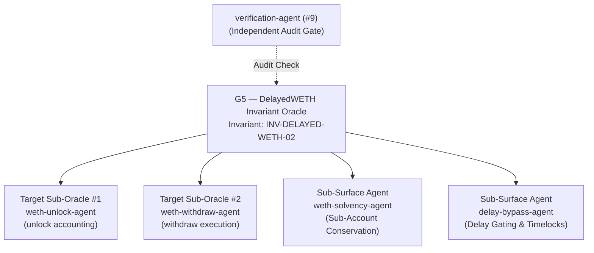

# G5 — DelayedWETH Invariant Oracle

**Slug:** `delayed-weth-invariant-oracle`  
**SKILL.md:** `.agents/skills/delayed-weth-invariant-oracle/SKILL.md`  
**Domain:** `bounties/base/contracts/src/L1/proofs/DelayedWETH.sol`  
**Supervised Invariant:** `INV-DELAYED-WETH-02` (DelayedWETH Sub-Account Solvency & Delay Integrity)  
**Privilege:** Read-Write on DelayedWETH invariant test harnesses; Read-Only on canonical protocol source.

---

## Purpose

The DelayedWETH Invariant Oracle (G5) governs invariant testing for the bonded collateral contract `DelayedWETH.sol`. It ensures that total WETH reserves strictly cover all pending delayed unlock claims, that sub-account balances cannot be stolen or diluted, and that unlock time locks cannot be bypassed under any execution path.

---

## Supervised Agents

| Agent | Level | Domain / Role |
|---|---|---|
| `weth-unlock-agent` | Target Sub-Oracle #1 | Verifies sub-account unlock initiation, timestamp recording, and allowance gating. |
| `weth-withdraw-agent` | Target Sub-Oracle #2 | Verifies post-delay withdrawal execution, balance subtractions, and reentrancy resistance. |
| `weth-solvency-agent` | Sub-Surface Attestation | Enforces mathematical solvency: `address(this).balance >= sum(subAccounts) + claims`. |
| `delay-bypass-agent` | Sub-Surface Attestation | Verifies timestamp checks (`block.timestamp >= unlocks[msg.sender].timestamp + delay()`) cannot be front-run or bypassed. |
| `verification-agent` | Audit Gate (#9) | Independently verifies all mathematical proofs against bytecode storage layouts. |

---

## Decision Authority

G5 has authority on:
- Formulating, testing, and verifying hypotheses targeting `DelayedWETH.sol`.
- Directing Target Sub-Oracles to construct targeted Forge fuzz and invariant harnesses.
- Signing off on whether DelayedWETH preserves total solvency across sub-account boundaries.
