# Tier 0 Fault Dispute & Multiproof Invariant Playbook

**Playbook Version:** `1.0.0`  
**Slug:** `tier0-fault-dispute-playbook`  
**Domain:** Base Tier 0 Settlement Layer (`bounties/base/contracts` & `bounties/base/base/crates`)  
**Target Contracts:** `OptimismPortal2.sol`, `DelayedWETH.sol`, `DisputeGameFactory.sol`, `AnchorStateRegistry.sol`, `TEEProverRegistry.sol`  
**Max Payout:** $5,000,000 (Tier 0 Critical)

---

## 1. Architecture Overview

This playbook operationalizes the Multi-Agent Invariant Architecture engineered for Base Tier 0 contracts. It coordinates 3 Invariant Orchestration Oracles (G4, G5, G6), 6 Target Sub-Oracles, and 7 Sub-Surface Attestation/Invariant Agents under the independent audit supervision of `verification-agent` (#9).

```mermaid
flowchart TD
    O1["G1 — Global Admin Oracle"] --> G4["G4 — Dispute Invariant Oracle<br/>(INV-DISPUTE-01)"]
    O1 --> G5["G5 — DelayedWETH Invariant Oracle<br/>(INV-DELAYED-WETH-02)"]
    O1 --> G6["G6 — Multiproof TEE Oracle<br/>(INV-MULTIPROOF-03)"]

    subgraph Dispute_Cluster ["Fault Dispute Cluster"]
        G4 --> SO1["Target Sub-Oracle #1: dispute-prove-agent"]
        G4 --> SO2["Target Sub-Oracle #2: dispute-finalize-agent"]
        G4 --> SA1["Sub-Surface: game-resolution-agent"]
        G4 --> SA2["Sub-Surface: blacklist-maturity-agent"]
    end

    subgraph WETH_Cluster ["DelayedWETH Cluster"]
        G5 --> SO3["Target Sub-Oracle #1: weth-unlock-agent"]
        G5 --> SO4["Target Sub-Oracle #2: weth-withdraw-agent"]
        G5 --> SA3["Sub-Surface: weth-solvency-agent"]
        G5 --> SA4["Sub-Surface: delay-bypass-agent"]
    end

    subgraph TEE_Cluster ["Multiproof TEE Cluster"]
        G6 --> SO5["Target Sub-Oracle #1: tee-register-agent"]
        G6 --> SO6["Target Sub-Oracle #2: tee-validity-agent"]
        G6 --> SA5["Sub-Surface: attestation-timestamp-agent"]
        G6 --> SA6["Sub-Surface: inverse-hint-integrity-agent"]
        G6 --> SA7["Sub-Surface: signer-lifecycle-agent"]
    end

    V9["#9: verification-agent<br/>(Independent Audit Gate)"] -.->|Audit Check| G4
    V9 -.->|Audit Check| G5
    V9 -.->|Audit Check| G6
```



---

## 2. Invariant Specifications

### A. Invariant INV-DISPUTE-01: Withdrawal Finalization Monotonicity
Governed by **Oracle G4 — Dispute Invariant Oracle**

$$\forall w \in \text{Withdrawals}, \text{finalized}(w) \implies \left( \text{status}(G_w) = \text{DEFENDER\_WINS} \land \text{claim}(G_w) = \text{root}_{\text{anchor}}(L2_{\text{block}}) \land t \ge t_{\text{proven}} + \Delta_{\text{maturity}} \right)$$

- **Core Condition**: A withdrawal cannot be finalized unless its dispute game $G_w$ resolved as `DEFENDER_WINS`, the game's root claim equals the finalized root recorded in `AnchorStateRegistry`, and `proofMaturityDelaySeconds` has elapsed.
- **Target Sub-Oracles**:
  - `dispute-prove-agent`: Storage trie inclusion proofs and dispute game proxy bindings.
  - `dispute-finalize-agent`: Reentrancy locks, finalization status, value transfer.
- **Sub-Surface Agents**:
  - `game-resolution-agent`: Checks `DEFENDER_WINS` and anchor root matching.
  - `blacklist-maturity-agent`: Enforces game blacklist and proof maturity delays.

### B. Invariant INV-DELAYED-WETH-02: DelayedWETH Sub-Account Solvency
Governed by **Oracle G5 — DelayedWETH Invariant Oracle**

$$\text{balanceOf}(\text{address}(DelayedWETH)) \ge \sum_{a \in \text{Accounts}} \text{subAccounts}[a] + \sum_{u \in \text{Unlocks}} \text{pendingAmount}(u)$$

- **Core Condition**: Total contract WETH reserves must strictly cover all sub-account bonded balances plus pending unlock requests. Withdrawals must strictly enforce the `delay()` parameter.
- **Target Sub-Oracles**:
  - `weth-unlock-agent`: Evaluates `unlock` scheduling and timestamp assignment.
  - `weth-withdraw-agent`: Evaluates `withdraw` execution and state zeroing.
- **Sub-Surface Agents**:
  - `weth-solvency-agent`: Probes conservation of WETH across concurrent sub-account operations.
  - `delay-bypass-agent`: Probes timelock integrity, front-running, and duplicate unlock handling.

### C. Invariant INV-MULTIPROOF-03: TEE Prover Signer Authenticity
Governed by **Oracle G6 — Multiproof TEE Invariant Oracle**

$$\forall s \in \text{Signers}, \text{isValidSigner}(s) \implies \left( \exists \text{doc} \in \text{Attestations} : \text{pubKey}(\text{doc}) = s \land \text{pcr0}(\text{doc}) = \text{TEE\_IMAGE\_HASH} \land \text{verifyCertChain}(\text{doc.certs}) \right)$$

- **Core Condition**: Only addresses whose public keys were signed by a valid AWS Nitro Enclave key with an unexpired certificate chain matching the expected `TEE_IMAGE_HASH` can be registered as valid signers.
- **Target Sub-Oracles**:
  - `tee-register-agent`: Evaluates `registerSigner` calldata, hints, and signatures.
  - `tee-validity-agent`: Evaluates `isValidSigner` and `isRegisteredSigner` queries.
- **Sub-Surface Agents**:
  - `attestation-timestamp-agent`: Probes `AttestationFromFuture` and `AttestationTooOld` limits.
  - `inverse-hint-integrity-agent`: Probes P-384 modular inverse hint transcripts and affine schedules.
  - `signer-lifecycle-agent`: Evaluates image rotation, deregistration, and health latching.

---

## 3. Operational Workflows & Commands

### Workflow 1: Fault Dispute Finalization Invariant Testing
```bash
export PATH="$HOME/.foundry/bin:$HOME/.cargo/bin:$PATH"
cd ~/projects/cantina/bounties/base/contracts

# Run OptimismPortal2 test suite
forge test --match-path "test/L1/OptimismPortal2.t.sol" -vvv

# Run AnchorStateRegistry test suite
forge test --match-path "test/L1/proofs/AnchorStateRegistry.t.sol" -vvv
```

### Workflow 2: DelayedWETH Solvency Invariant Testing
```bash
export PATH="$HOME/.foundry/bin:$HOME/.cargo/bin:$PATH"
cd ~/projects/cantina/bounties/base/contracts

# Run DelayedWETH test suite
forge test --match-path "test/L1/proofs/DelayedWETH.t.sol" -vvv
```

### Workflow 3: TEE Prover Registry Attestation Invariant Testing
```bash
export PATH="$HOME/.foundry/bin:$HOME/.cargo/bin:$PATH"
cd ~/projects/cantina/bounties/base/contracts

# Run TEEProverRegistry test suite
forge test --match-path "test/L1/proofs/TEEProverRegistry.t.sol" -vvv
```

---

## 4. Verification & Audit Protocol

1. **Independent Verification**: No finding or hypothesis state transition (`ACTIVE` → `PROVEN` or `HOLD`) is approved without independent replication by `verification-agent` (#9).
2. **Provenance Requirement**: Every claim must cite specific contract lines (`[SRC: path#Lxx]`), execution tools (`[TOOL: forge/cargo]`), and reproducible proof files (`[POC: path]`).
3. **Safety Compliance**: All tests run strictly within the local EVM container or sandbox with zero live-fund interactions.
