# Glassbox Mirror Plane to UOOMA Lifecycle Mapping

## Pack B Static Analysis & SARIF Collection Lifecycle (UAIA v1.0.0)

**Document Version:** 1.0.0  
**Specification Reference:** [META_PERSONA.md](./META_PERSONA.md) Section 7 & Section 8  
**Governing Architecture:** Universal Oracle–Orchestrator Meta-Agent (`UOOMA-PACK-B`)  
**Host Operation Pipeline:** `universal_adaptive_engine.workflows.operations.sarif_pipeline.SARIFCollectionPipeline`  
**Execution Engine:** `workflows/pack-b-static/sarif_collector.py`  
**CLI Wrapper:** `workflows/pack-b-static/workflow-sarif-collector.sh`  

---

## 1. High-Level Architectural Synthesis

The system connects three complementary dimensions of workflow execution:
1. **Governance & Responsibility Layers (UOOMA 7 Layers):** Oracle, Orchestrator, Specialists, Testing, Challenger, Admission, and Audit.
2. **Evidence Transformation Disciplines (Glassbox Mirror Plane 8 Stages):** Perception, Parsing, Preceptive Interpretation, Planning, Reasoning, Context Modeling, Semantic Awareness, and Meta-Governance.
3. **Operational Execution Sequence (14-Stage Collector Lifecycle):** Sequential, deterministic processing pipeline from intake to final read-back and audit.

```mermaid
flowchart TD
    subgraph Glassbox["Glassbox Mirror Plane (8 Stages)"]
        G1["Stage 1: Perception Filtering"]
        G2["Stage 2: Parsing & Tokenization"]
        G3["Stage 3: Preceptive Interpretation"]
        G4["Stage 4: Thinking & Planning"]
        G5["Stage 5: Reasoning & Verification"]
        G6["Stage 6: Context & Scope Modeling"]
        G7["Stage 7: Awareness & Semantic Reconciliation"]
        G8["Stage 8: Meta-Governance & Admission"]
    end

    subgraph UOOMA["UOOMA 7-Layer Responsibility"]
        L1["Layer 1: Oracle & Policy"]
        L2["Layer 2: Orchestrator"]
        L3["Layer 3: Specialist Execution"]
        L4["Layer 4: Testing & Verification"]
        L5["Layer 5: Independent Challenger"]
        L6["Layer 6: Admission & Release"]
        L7["Layer 7: Audit & Observability"]
    end

    subgraph Collector["14-Stage Execution Lifecycle"]
        S1["1. INTAKE"]
        S2["2. AUTHORIZATION"]
        S3["3. DISCOVERY"]
        S4["4. SCOPE_VALIDATION"]
        S5["5. INVENTORY"]
        S6["6. INPUT_VALIDATION"]
        S7["7. NORMALIZATION"]
        S8["8. DEDUPLICATION"]
        S9["9. ASSEMBLY"]
        S10["10. SCHEMA_VALIDATION"]
        S11["11. CHALLENGE"]
        S12["12. PUBLICATION"]
        S13["13. READ_BACK_VERIFICATION"]
        S14["14. AUDIT_AND_FINALIZE"]
    end

    G1 --> S1 & S4 & S5
    G2 --> S6
    G3 --> S7 & S10
    G4 --> S2 & S3 & S9
    G5 --> S8 & S10 & S13
    G6 --> S4
    G7 --> S11
    G8 --> S12 & S14

    L1 --- G1 & G8
    L2 --- G4
    L3 --- G2 & G3
    L4 --- G5
    L5 --- G7
    L6 --- G8
    L7 --- G8
```

---

## 2. Stage-by-Stage Operational Mapping Matrix

| Stage | Glassbox Stage | UOOMA Layer | Code Entry Point (`sarif_collector.py`) | Inputs | Outputs | Evidence Generated | Failure Transition | Mandatory Gate |
|---|---|---|---|---|---|---|---|---|
| **1. INTAKE** | 1. Perception | Layer 1: Oracle | `main()` / `__init__()` | CLI args (`--slug`, `--mode`) | Validated slug & mode | `args_parsed` record | `INVALID_INPUT` (Exit 2) | Slug regex check |
| **2. AUTHORIZATION** | 4. Planning | Layer 1: Oracle | `stage_1_and_2_preflight()` | Flags (`--dry-run`, `--confirm`) | `write_allowed` boolean | `policy_governance` | `POLICY_BLOCK` (Dry run) | `WRITE_ALLOWED = CONFIRM && !DRY_RUN` |
| **3. DISCOVERY** | 4. Planning | Layer 2: Orchestrator | `parse_tooling_registry()` | `global/tooling.md` | Active tool capability map | `provenance.tool_versions` | `TOOL_UNAVAILABLE` | Tool status in tooling.md |
| **4. SCOPE_VALIDATION** | 6. Context Modeling | Layer 3: Filesystem Specialist | `__init__()` | Target root & repo root | Resolved `scan_dir` path | `Path.is_relative_to` result | `PERMISSION_DENIED` (Exit 2) | Deny traversal & escapes |
| **5. INVENTORY** | 1. Perception | Layer 3: Filesystem Specialist | `stage_3_inventory()` | `bounties/<slug>/scans` | Candidate file paths | List of `.sarif` / `.json` | `MISSING_CONTEXT` | Enumerate without write |
| **6. INPUT_VALIDATION** | 2. Parsing | Layer 3: Parsing Specialist | `stage_4_to_6_parse_and_normalize()` | Raw file bytes | Parsed JSON objects | Size check, parser errors | `INVALID_INPUT` (Logged to rejected) | Enforce 50MB limit & syntax |
| **7. NORMALIZATION** | 3. Preceptive Interpretation | Layer 3: SARIF Specialist | `_normalize_single_scan()` | Slither / Aderyn / Semgrep / SARIF | Canonical SARIF runs | Transformed rules & locations | `REJECTED_INPUT` (Preserved in audit) | No invented findings |
| **8. DEDUPLICATION** | 5. Reasoning | Layer 3: SARIF Specialist | `stage_7_deduplicate()` | Raw findings array | Unique findings array | `ruleId:path:line:hash` map | `INTEGRITY_FAILURE` | Deterministic ordering |
| **9. ASSEMBLY** | 4. Planning | Layer 2: Orchestrator | `stage_8_and_9_serialize_and_validate()` | Deduplicated runs & provenance | Serialized artifact payload | Structured audit payload | `INTEGRITY_FAILURE` | Reconcile counts |
| **10. SCHEMA_VALIDATION** | 3. Preceptive Interpretation | Layer 4: Testing & Verification | `_validate_schema()` | Serialized artifact | Schema pass/fail boolean | jsonschema validation result | `TEST_FAILURE` (Exit 1) | Strict schema conformance |
| **11. CHALLENGE** | 7. Awareness | Layer 5: Challenger | `SARIFCollectorChallengerWorkflow` | Candidate artifact | Adversarial review results | Counterexample check | `POLICY_BLOCK` (Veto) | Challenger veto authority |
| **12. PUBLICATION** | 8. Meta-Governance | Layer 6: Admission | `stage_10_to_14_publish_and_verify()` | Candidate artifact | Atomically published file | Temporary swap receipt | `INTEGRITY_FAILURE` (Rollback) | Atomic `.tmp` replacement |
| **13. READ-BACK VERIFICATION** | 5. Reasoning | Layer 4: Testing & Verification | `stage_10_to_14_publish_and_verify()` | Published file on disk | Exact-byte SHA-256 digest | Verified cryptographic digest | `INTEGRITY_FAILURE` (Exit 1) | Read-back digest match |
| **14. AUDIT_AND_FINALIZE** | 8. Meta-Governance | Layer 7: Audit | `execute()` / `HandoffRecord` | Final status & evidence | Completion report & receipt | `HandoffRecord` envelope | `FAILED` / `BLOCKED` | Final status reconciliation |

---

## 3. Synchronization Barriers & Execution Rules

1. **Barrier 1 (Scope & Authorization Gate):**  
   Occurs between Stage 4 and Stage 5. If `Path.is_relative_to` fails or target slug contains illegal characters, execution terminates with exit code 2. No scan directory reads occur.
2. **Barrier 2 (Pre-Publication Semantic & Schema Gate):**  
   Occurs between Stage 10 and Stage 12. If schema validation fails, or finding counts do not reconcile (`raw == sum(tool_breakdown) + dropped`), publication is halted. The temporary file is purged and the previous valid artifact remains byte-for-byte untouched.
3. **Barrier 3 (Post-Publication Cryptographic Gate):**  
   Occurs at Stage 13. The newly published artifact is re-read from disk, re-parsed, and its exact-byte SHA-256 digest is verified. If the read-back digest fails, status `FAILED` is assigned and an integrity alert is emitted.
4. **Barrier 4 (Independent Challenger Veto):**  
   The Independent Challenger role retains unconditional veto power. An artifact cannot be admitted to `COLLECTED` status if any adversarial negative control (symlink defense, corruption handling, zero-mutation dry-run) fails.
