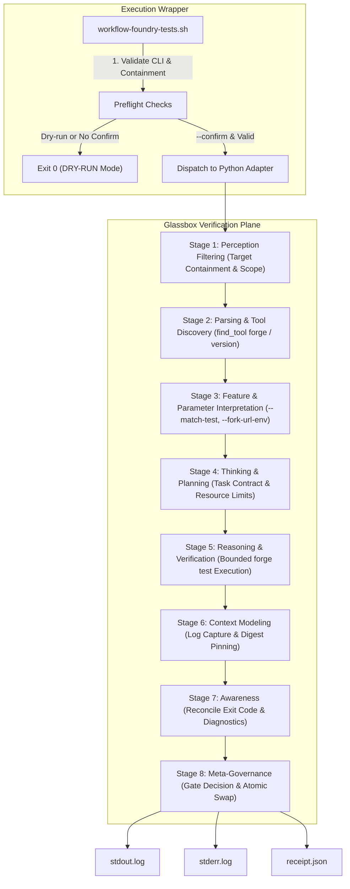

# Pack C — Dynamic Analysis & Verification Workflows

## Universal Adaptive Security Verification Meta-Agent Profile

**Workflow Profile:** `UAIA-PACK-C-DYNAMIC`  
**Architecture:** Universal Adaptive Security Verification / Glassbox Mirror Plane Orchestration  
**Specification Document:** [META_PERSONA.md](./META_PERSONA.md)  
**Machine-Readable Tool Registry:** [tool_registry.json](./tool_registry.json)  
**Automated Test Suite:** [tests/test_workflow_foundry.sh](./tests/test_workflow_foundry.sh)  
**Canonical Manifests & Receipts:** `bounties/<slug>/scans/foundry/receipt.json`  
**Schema Definitions:** [schemas/](./schemas/)  

---

## 1. Architecture Overview

Pack C coordinates dynamic security testing and verification for Solidity smart contracts under the Universal Adaptive Intelligence Architecture (UAIA) and the Glassbox Mirror Plane Orchestration protocol.

The system is factored into three cooperating layers:
1. **Execution Wrappers (`workflow-foundry-tests.sh`, `workflow-echidna.sh`, `workflow-fuzz.sh`):**
   - Strictly parse CLI arguments (`require_value`, reject unknown flags).
   - Enforce workspace containment (`resolve_repo_path`, leaf symlink checks against `REPO_ROOT`).
   - Enforce fail-closed `--dry-run` precedence.
   - Guard against non-directory output paths and missing dependencies.
   - Invoke backend adapters via safe argument arrays.
2. **Meta-Agent Policy & Tool Registry (`META_PERSONA.md`, `tool_registry.json`):**
   - Governs behavioral policy, authority hierarchies, capability discovery, task and finding contracts, fail-closed gates, and independent review.
   - Provides a machine-readable registry of 15 essential capabilities with input/output schemas, permissions, and risk classifications.
3. **Glassbox Verification Plane (`foundry_adapter.py`, `echidna_adapter.py`, `echidna_contracts.py`):**
   - Independently enforces path containment against `REPO_ROOT` (defense-in-depth).
   - Isolates stdout/stderr logs with cryptographic SHA-256 digests.
   - Serializes receipts atomically via temporary file replacement (`os.fsync` and `os.replace`).
   - Strictly propagates subprocess execution status.



---

## 2. Operating Modes & Invariants

| Invariant | Description |
|---|---|
| **Dry-Run Precedence** | `--dry-run` always overrides `--confirm`. Zero filesystem modifications occur during dry-run. |
| **Authorization Gate** | Missing `--confirm` prevents live test execution; reports dry-run preview without writing artifacts. |
| **Execution != Verification** | Process exit code 0 establishes only what tests passed under recorded conditions. Findings require independent falsification checks. |
| **Strict Containment** | Traversal sequences (`..`), symlink escapes (including final-component leaf symlinks), or paths escaping `REPO_ROOT` are rejected with exit code 1. |
| **Adapter Defense-in-Depth** | Python adapters independently verify `Path.is_relative_to(REPO_ROOT)` rather than trusting shell wrappers. |
| **Atomic Serialization** | All receipt, manifest, and finding writes occur via `.tmp.<pid>` before renaming via `os.replace`. |
| **Dual-Tier Integrity** | Payloads embed cryptographic SHA-256 digests; receipts record exact-byte disk hashes post-swap. |

---

## 3. CLI Usage

### Foundry Unit Tests Wrapper
```bash
./workflow-foundry-tests.sh [OPTIONS]

Options:
  --dry-run             Validate and preview without executing changes (default).
  --confirm             Explicitly authorize adapter's confirmed mode.
  --target PATH         Target directory, relative to repository root (default: bounties/base).
  --output-dir PATH     Output directory, relative to repository root (default: bounties/base/scans/foundry).
  --repo-root PATH      Repository root (default: /home/nova/projects/cantina).
  --match-test FILTER   Filter tests by pattern/regex.
  --fork-url-env VAR    Name of environment variable containing RPC URL.
  --fork-block NUM      Pinned fork block number.
  -h, --help            Show help message and exit 0.
```

### Foundry Fuzz Tests Wrapper (Bounded Forge Fuzz)
```bash
./workflow-fuzz.sh [OPTIONS]
# or via root script symlink:
../../scripts/bounded_forge_fuzz.sh [OPTIONS]

Options:
  --target PATH       Target directory relative to repository root (default: bounties/base).
  --output-dir PATH   Output directory relative to repository root (default: bounties/base/scans/fuzz).
  --dry-run           Validate and preview without executing fuzz tests (default).
  --confirm           Authorize execution, subject to runtime policy.
  -h, --help          Show help message and exit 0.

Execution is dry-run by default. --dry-run and --confirm are mutually exclusive.
```

### Medusa Dynamic Property Fuzzing Wrapper
```bash
./workflow-medusa.sh [OPTIONS]

Options:
  --slug SLUG                  Target bounty workspace under bounties/ (default: base)
  --target PATH                Solidity target directory or source file (default: bounties/<slug>/contracts)
  --config PATH                Medusa configuration JSON file
  --timeout SECONDS            Campaign timeout in seconds (default: 60)
  --test-limit INTEGER         Maximum number of test transactions to execute
  --workers INTEGER            Number of parallel fuzzer workers
  --seed INTEGER               Deterministic random seed (non-negative integer)
  --report-dir, --output-dir,
  --artifacts PATH             Directory for campaign output artifacts
  --dry-run                    Validate configuration without running fuzzing
  --confirm                    Explicitly authorize live fuzzing execution
  -h, --help                   Display help message and exit 0

Environment:
  MEDUSA_COMMAND               Optional reviewed absolute executable command for fuzzing
```

### Echidna Dynamic Property Fuzzing Wrapper
```bash
./workflow-echidna.sh [OPTIONS]

Options:
  --slug SLUG                  Target bounty workspace under bounties/ (default: base)
  --target PATH                Solidity target directory or source file (default: bounties/<slug>/contracts)
  --config PATH                Echidna configuration YAML/JSON file
  --contract CONTRACT          Specific contract name to analyze
  --test-mode MODE             Echidna test mode: property, assertion, overflow, exploration (default: property)
  --test-limit INTEGER         Maximum number of test sequences to execute
  --seed INTEGER               Deterministic random seed (non-negative integer)
  --timeout SECONDS            Campaign timeout in seconds (default: 60)
  --artifacts, --output-dir P  Directory for campaign output artifacts
  --dry-run                    Validate prerequisites and preview without running fuzzing
  --confirm                    Explicitly authorize live fuzzing execution
  -h, --help                   Display help message and exit 0
```

### Direct Foundry Adapter Invocation
```bash
python3 .agents/skills/qrpe/adapters/foundry_adapter.py \
  --target /path/to/target \
  --output-dir /path/to/output \
  [--match-test PATTERN] \
  [--fork-url-env ENV_VAR] \
  [--fork-block BLOCK_NUM] \
  [--timeout SECONDS] \
  [--dry-run] \
  [--confirm]
```

### Direct Medusa Adapter Invocation
```bash
python3 .agents/skills/qrpe/adapters/medusa_adapter.py \
  --target /path/to/target \
  --output-dir /path/to/output \
  [--config /path/to/medusa.json] \
  [--timeout SECONDS] \
  [--test-limit TRANSACTIONS] \
  [--workers WORKERS] \
  [--dry-run] \
  [--confirm]
```

### Automated Acceptance & Production Validation Suites
```bash
# Bounded Forge Fuzz Acceptance Test Suite (29 tests)
./tests/test_workflow_fuzz.sh

# Medusa Property Fuzzing Integration Suite (36 tests)
./tests/test_workflow_medusa.sh

# Echidna Property Fuzzing Integration Suite (20 tests)
./tests/test_workflow_echidna.sh

# Foundry Unit Tests Validation Suite (16 tests)
./tests/test_workflow_foundry.sh

# Pytest Invariant & Fuzz Runner Suites (69 tests)
python3 -m pytest -v tests/
```

---

## 4. Exit Codes

- `0`: Success (including verified dry-run preview and clean verified campaigns).
- `1`: Execution failure, test failure, invariant falsification, or schema validation failure.
- `2`: CLI parsing error, missing option value, conflicting execution flags, path traversal, or sandbox escape failure.
- `3`: Missing tool, missing target directory, or unresolvable scope.
- `124`: Execution timeout.
